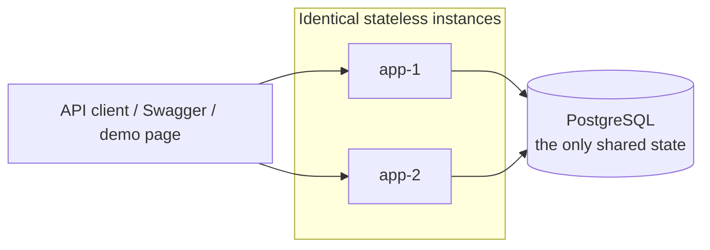
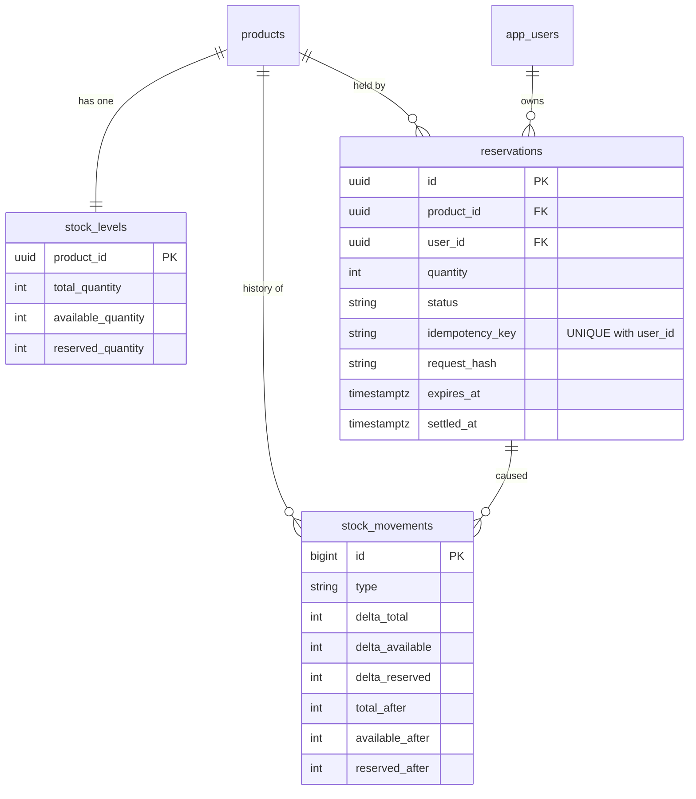
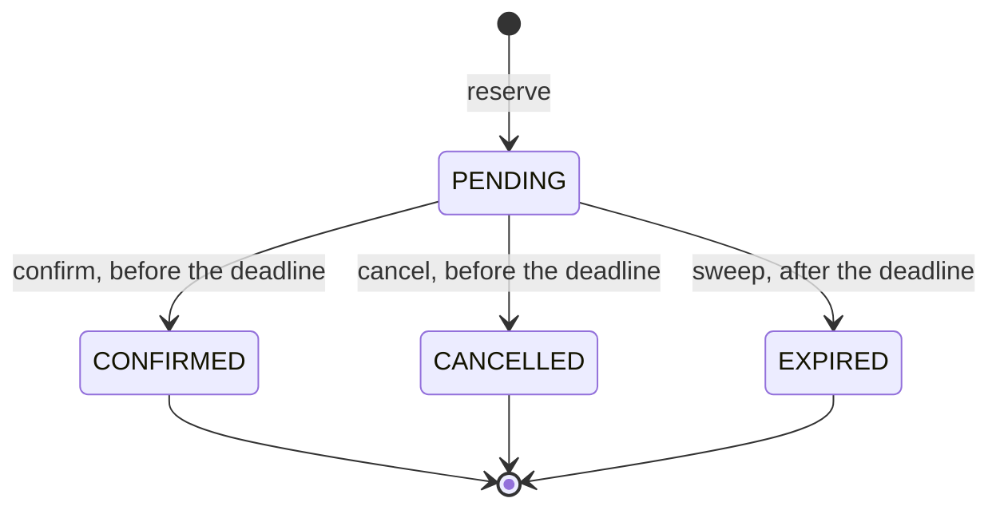
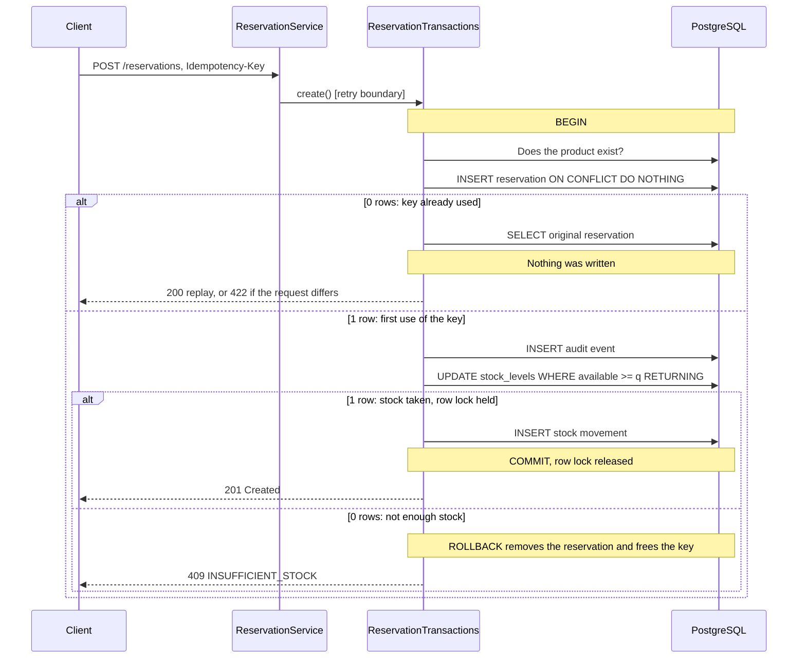
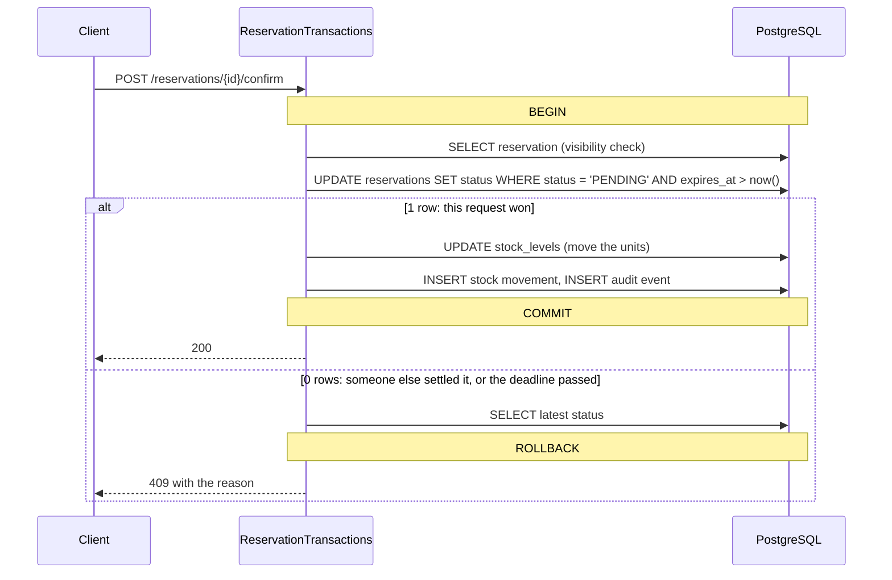

# Architecture

StockGuard is a modular monolith: one deployable Spring Boot application, split into feature packages, running as
any number of identical instances in front of one PostgreSQL database. Microservices would add distributed
transactions, which is the very problem this project avoids by keeping every invariant inside one ACID database.



Instances share nothing except the database: no session, no cache, no in-memory lock. That is what makes the
concurrency guarantees independent of the number of instances.

## Packages

| Package | Responsibility |
|---|---|
| `reservation` | Reservation lifecycle, idempotency, expiry. The core of the system. |
| `inventory` | Stock counters, the append-only stock ledger, the consistency verifier. |
| `catalog` | Product data, with optimistic locking for edits. |
| `audit` | Append-only record of who did what, written inside the business transaction. |
| `user` | Registration, login, administrator seeding. |
| `security` | JWT issuing and verification, URL authorisation rules, problem responses for 401 and 403. |
| `simulation` | Demo-only concurrency race, enabled by configuration. |
| `common` | Configuration properties, error contract, shared web types. |

`reservation` and `catalog` depend on `inventory` and `audit`, never the other way round: `inventory` knows nothing
about products or reservations beyond their ids. `simulation` prepares its data through the services, then sends the
race itself over HTTP like any other client.

## Layers

| Layer | Example | Rule |
|---|---|---|
| Controller | `ReservationController` | HTTP only: maps DTOs, validates input, chooses status codes. No business decisions. |
| Retry boundary | `ReservationService` | Bounded retry of transient lock failures. Holds no transaction. |
| Transaction | `ReservationTransactions`, `ReservationExpiryService` | Each method is one all-or-nothing unit. Business decisions live here. |
| Gateway | `StockLedger`, `AuditTrail` | The only way to change stock or write audit events. Refuses to run without a surrounding transaction. |
| Repository | `StockLevelRepository`, `ReservationRepository` | The atomic SQL statements that actually enforce the rules. |
| Entity | `Reservation`, `StockLevel` | Read models. See below. |

### Why most entities are read-only

`Reservation`, `StockLevel`, `StockMovement`, `AuditEvent` and `AppUser` are annotated `@Immutable`, have no setters,
and their repositories extend Spring Data's narrow `Repository` interface, so no generic `save()` exists for
reservations or stock. This is a deliberate guard. The usual JPA pattern is to load an entity, change a field and let
Hibernate flush it, but that is a read-then-write: two transactions can load the same row and the second write
overwrites the first. Here that mistake does not compile.

`Product` is the exception. It is a normal mutable entity with `@Version`, because catalogue edits are rare and a
conflict should be resolved by a person who reloads and sees the new values.

## Data model



`audit_events` also records changes, but has no foreign key to the changed row since it describes many entity types.

Stock counters live in their own table, not on `products`. `stock_levels` is the hottest row in the system, and
splitting it off means a catalogue edit and a reservation never compete for the same row lock, and stock activity
never bumps the product's `@Version` (`ProductCatalogIT` verifies this).

### What the database enforces by itself

Application code is the first line of defence. These hold even if it has a bug:

| Rule | Mechanism |
|---|---|
| Stock can never be negative | `CHECK (available_quantity >= 0)`, `CHECK (reserved_quantity >= 0)` |
| `total = available + reserved` | `CHECK` on `stock_levels` |
| One reservation per user and idempotency key | `UNIQUE (user_id, idempotency_key)` |
| A settled reservation never changes | `BEFORE UPDATE` trigger |
| A reservation's product, user and quantity never change | `BEFORE UPDATE` trigger |
| `settled_at` is set exactly when the status is final | `CHECK` on `reservations` |
| Ledger and audit trail are append-only | `BEFORE UPDATE OR DELETE` triggers |

## Reservation state machine



| Operation | total | available | reserved |
|---|---|---|---|
| Stock received (+q) | +q | +q | |
| Reserve (q) | | -q | +q |
| Confirm (q) | -q | | -q |
| Cancel or expire (q) | | +q | -q |

Confirmation does not touch `available`: those units left it when they were reserved. Reducing it again is the
double decrement this table exists to prevent.

The deadline splits time cleanly in two. Before it, only a client can settle the reservation; after it, only the
sweeper can. A reservation past its deadline that the sweeper has not reached yet still answers `RESERVATION_EXPIRED`
to confirm and cancel, so the sweep interval affects when stock returns, never whether a late confirmation succeeds.

## Transaction flows

### Create a reservation



The stock update comes last on purpose. Its row lock is the bottleneck for that product and lasts until commit, so
everything that can run before it does.

### Confirm or cancel



### Expire

Each instance runs the sweep every few seconds. No leader election is needed.

1. One statement claims a batch: `SELECT ... WHERE status = 'PENDING' AND expires_at <= now() FOR UPDATE SKIP LOCKED`
   inside an `UPDATE ... RETURNING`.
2. Claimed rows are sorted by product id, so stock rows are always locked in the same order.
3. Each reservation's units are released and recorded in the ledger and the audit trail.
4. Everything commits together; a failure rolls the whole batch back and the next sweep tries again.

## Lock order

Every transaction that takes more than one lock takes them in the same order, which rules out deadlocks between them:

```
reservation row  →  stock row(s), in ascending product id  →  ledger and audit inserts (no contention)
```

## Time

All deadlines are compared with PostgreSQL's `now()`, never the JVM clock. Instances may disagree about the time,
but they all ask the same clock, so clock skew cannot make them disagree about whether a reservation has expired.

## Errors

Every failure is an RFC 9457 problem document with a stable `code`, including 401 and 403 from the security filter
chain, so clients never have to parse messages.

| Status | `code` | Meaning |
|---|---|---|
| 400 | `VALIDATION_FAILED` | Invalid body, parameter or `Idempotency-Key`, with field details in `errors` |
| 401 | `UNAUTHENTICATED`, `INVALID_CREDENTIALS` | Missing or invalid token, or failed login |
| 403 | `ACCESS_DENIED` | Authenticated, but not allowed |
| 404 | `PRODUCT_NOT_FOUND`, `RESERVATION_NOT_FOUND` | Does not exist, or belongs to someone else |
| 409 | `INSUFFICIENT_STOCK` | Not enough stock; retry later with the same key |
| 409 | `RESERVATION_ALREADY_SETTLED`, `RESERVATION_EXPIRED` | The reservation can no longer change |
| 409 | `STALE_VERSION`, `SKU_TAKEN`, `USERNAME_TAKEN` | Lost an edit race, or the unique value exists |
| 422 | `IDEMPOTENCY_KEY_REUSED` | The key was already used for a different request |
| 503 | `TEMPORARILY_UNAVAILABLE` | Lock contention or database outage, with `Retry-After`; safe to retry with the same key |
| 500 | `INTERNAL_ERROR` | A bug. Rolled back and logged; no internals in the response |

A database constraint violation other than a known unique key maps to 500, not 409: application code tried to break
an invariant, and calling that a client error would hide the bug.

## Security

- **Stateless JWT (HS256).** Any instance verifies a token issued by any other. Issuer, expiry and signature are all
  checked, and `alg=none` and tampered tokens are rejected.
- **Authorisation** is one table of URL rules in `SecurityConfig`, ending in `anyRequest().authenticated()`, so a new
  endpoint is protected by default.
- **Ownership:** another user's reservation answers 404, not 403, so ids cannot be probed.
- **Passwords:** BCrypt, with a 72 byte limit enforced instead of silently truncating.
- **Login:** an unknown user and a wrong password give the same answer, and Spring Security equalises the timing.
- **No built-in credentials:** the application will not start without a JWT secret of at least 32 characters, and
  Docker Compose will not start without all three secrets.
- **Registration** can only create the `USER` role. The first administrator comes from environment variables.

## Connection and timeout settings

| Setting | Value | Why |
|---|---|---|
| `spring.jpa.open-in-view` | `false` | A connection is held only during a transaction, never while rendering a response |
| Pool size | 20 per instance | Requests beyond it queue in the application rather than overloading PostgreSQL |
| `lock_timeout` | 3 s | A request cannot wait forever on a stuck row. Must exceed `deadlock_timeout` (1 s) so deadlocks are reported as such |
| `idle_in_transaction_session_timeout` | 30 s | A hung client cannot pin a row lock |
| Isolation for writes | READ COMMITTED | Enough, because each decision is one atomic statement. See [concurrency.md](concurrency.md) |
| Isolation for the consistency report | REPEATABLE READ | All rules see one snapshot while writes continue |

## Known limitations

These are deliberate scope decisions, listed so that nobody has to discover them:

- **Hot row throughput.** All reservations of one product serialise on one row, so throughput per product is bounded
  by commit latency. Different products do not affect each other. Hot-item sales at very large scale would call for
  splitting a product's stock across several rows.
- **Single database.** PostgreSQL is a single point of failure here. Replication and failover are out of scope, and
  asynchronous replication could lose commits that this design treats as durable.
- **Idempotency keys are kept forever,** since they live on the reservation. A real deployment would archive old rows.
- **Stock receipts are not idempotent.** A retried `POST /stock` adds stock twice. The requirement covered reservations.
- **A confirmed reservation cannot be cancelled.** Returns would be a separate, additional stock movement.
- **JWTs cannot be revoked** before they expire (60 minutes), and **login is not rate limited**. A production deployment
  would add both, typically at the gateway.
- **A corrupt row can stall a sweep batch.** Since a batch commits as one unit, a reservation whose release keeps
  failing blocks expiry behind it. This requires already corrupt data, which the consistency check reports.
- **The application connects as the database owner.** A hardened deployment would use a role that cannot alter tables
  or disable the triggers.
